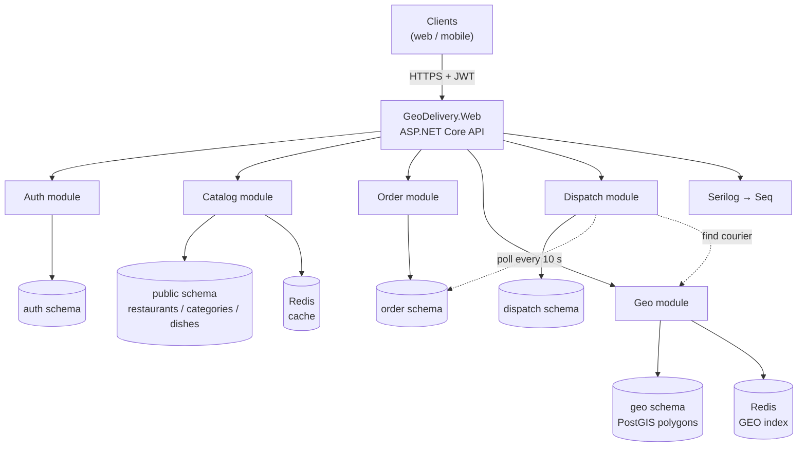
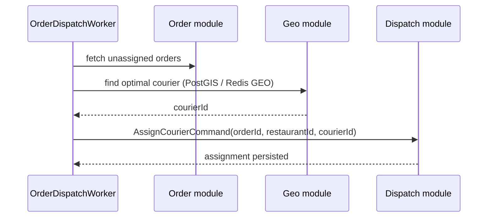

# GeoDelivery

**A modular-monolith food delivery backend built with .NET 10, Domain-Driven Design, CQRS, PostgreSQL/PostGIS and Redis.**

GeoDelivery is an actively developed backend platform for ordering food and dispatching couriers. Instead of splitting a young product into dozens of distributed services, the system keeps a **single deployable API** while isolating every business capability into its own module, database schema and application pipeline.


---

## Table of contents

- [Why a modular monolith?](#why-a-modular-monolith)
- [Features](#features)
- [Architecture](#architecture)
- [Solution structure](#solution-structure)
- [Tech stack](#tech-stack)
- [Getting started](#getting-started)
- [Database & migrations](#database--migrations)
- [Configuration](#configuration)
- [API reference](#api-reference)
- [Example requests](#example-requests)
- [Design decisions](#design-decisions)
- [Background services](#background-services)
- [Current status](#current-status)
- [Roadmap](#roadmap)
- [Contributing](#contributing)
- [License](#license)

---

## Why a modular monolith?

A delivery platform naturally consists of several subdomains: identity, restaurant catalog, orders, geospatial delivery zones and courier dispatch. GeoDelivery models them as independent modules inside one process:

- **Clear boundaries** — modules keep their own domain model, application handlers and `DbContext`.
- **Separate schemas** — one PostgreSQL database, but each module owns its schema (`auth`, `geo`, `order`, `dispatch`); the catalog lives in `public`.
- **No distributed transactions** — cross-module communication happens in-process through MediatR instead of HTTP calls between services.
- **A migration path to microservices** — a module can be extracted later without rewriting its domain layer.

This gives the development speed of a monolith with most of the modularity benefits of microservices, without premature operational complexity.

---

## Features

### Implemented

- **Authentication & authorization**
  - Registration and login with ASP.NET Core Identity.
  - JWT access tokens and rotating refresh tokens.
  - Refresh tokens stored in PostgreSQL; a daily background service removes stale tokens.
  - Role-based endpoint protection (`Admin`, `Manager`, `Courier`, `Client`).
- **Restaurant catalog**
  - Restaurants, categories and dishes with validation.
  - Restaurant → category → dish relationships.
  - Dish availability toggling.
  - Read-through Redis caching for selected queries.
- **Ordering**
  - Create an order with delivery coordinates and line items.
  - Retrieve an order with its items.
  - Cancel an order; totals are calculated from line items.
  - Order lifecycle statuses (`Created → Accepted → Cooking → ReadyForDelivery → Delivering → Completed / Cancelled`).
- **Geospatial services**
  - Delivery zones stored as PostGIS polygons (SRID 4326) with a GiST index.
  - Point-in-zone checks, nearest-zone lookup and distance calculation.
  - Live courier positions in Redis GEO sets; nearby-courier search by radius.
- **Dispatch**
  - `CourierAssignment` aggregate and assignment statuses.
  - Background worker scaffold for automatic courier assignment.
- **Platform**
  - MediatR CQRS pipeline with validation and caching behaviors.
  - Centralized exception handling that maps domain errors to JSON responses (and unexpected errors to `ProblemDetails`).
  - Structured logging with Serilog to console, rolling files and Seq.
  - Swagger / OpenAPI UI.
  - GUID v7 identifiers for time-ordered keys where the domain entities use them.
  - Snake-case PostgreSQL naming via `EFCore.NamingConventions`.

### In progress

- Fully wired dispatch worker (currently uses a placeholder pending-order list).
- End-to-end authorization on the ordering endpoints.
- Role seeding and admin bootstrap.
- Automated tests and CI.

---

## Architecture



Every module follows the same internal layout:

```text
<Module>/
├── Domain/          # Entities, value objects, enums, DTOs
├── Application/     # Commands, queries, handlers, validators, pipeline behaviors
├── Infrastructure/  # DbContext, EF Core configurations, migrations, external services
└── Presenters/      # API controllers
```

`Web` is the composition root: it references all modules, registers their services and hosts the HTTP pipeline. Modules do **not** reference each other; shared behavior is expressed through MediatR requests or infrastructure services.

---

## Solution structure

```text
GeoDelivery/
├── GeoDelivery.sln
├── docker-compose.yml          # PostgreSQL/PostGIS + Seq
│
├── Auth/                       # Identity, JWT, refresh tokens
├── Catalog/                    # Restaurants, categories, dishes, Redis cache
├── Order/                      # Orders and order items
├── Geo/                        # PostGIS zones + Redis GEO courier tracking
├── Dispatch/                   # Courier assignment + dispatch worker
│
└── Web/                        # Composition root, DI, middleware, Swagger
    ├── Extensions/             # Service registration extension methods
    ├── Middlewares/Exceptions/ # IExceptionHandler implementations
    ├── appsettings.json
    └── Program.cs
```

### Module map

| Module | Responsibility | Persistence |
| --- | --- | --- |
| **Auth** | Users, roles, JWT issuing, refresh-token rotation and cleanup | PostgreSQL `auth` schema |
| **Catalog** | Restaurants, categories, dishes, availability, cached reads | PostgreSQL `public` schema + Redis |
| **Order** | Order creation, totals, statuses, cancellation | PostgreSQL `order` schema |
| **Geo** | Delivery-zone polygons, distance calculations, courier locations | PostgreSQL `geo` schema + Redis GEO |
| **Dispatch** | Courier assignments and background assignment loop | PostgreSQL `dispatch` schema |
| **Web** | HTTP pipeline, DI composition, error mapping, OpenAPI, logging | — |

---

## Tech stack

| Area | Technology |
| --- | --- |
| Runtime | .NET 10 / ASP.NET Core |
| Language | C# 14 |
| Architecture | Modular monolith, DDD, CQRS |
| Messaging in-process | MediatR 14 |
| Validation | FluentValidation 12 |
| Persistence | EF Core 10, Npgsql |
| Database | PostgreSQL 16 + PostGIS 3.4 |
| Geospatial | NetTopologySuite, PostGIS, Redis GEO |
| Caching | Redis (`StackExchange.Redis`) |
| Identity | ASP.NET Core Identity |
| Auth | JWT Bearer + refresh tokens |
| Logging | Serilog (console, file, Seq) |
| API docs | Swagger / Swashbuckle |
| Containers | Docker Compose (infrastructure) |

---

## Getting started

### Prerequisites

- [.NET 10 SDK](https://dotnet.microsoft.com/download) (the solution targets `net10.0`)
- [Docker Desktop](https://www.docker.com/products/docker-desktop/) (or compatible Docker engine)
- [EF Core CLI](https://learn.microsoft.com/ef/core/cli/dotnet) for migrations
- Redis 7 (see below; the current `docker-compose.yml` starts PostgreSQL and Seq only)

### 1. Clone the repository

```bash
git clone https://github.com/ToshmatovDeveloper/GeoDelivery.git
cd GeoDelivery/GeoDelivery
```

### 2. Start infrastructure

```bash
docker compose up -d
```

This starts:

| Service | URL / port | Credentials |
| --- | --- | --- |
| PostgreSQL 16 + PostGIS | `localhost:5432` | `postgres` / `postgres`, database `catalog_service_db` |
| Seq | <http://localhost:8080> (UI), `localhost:5341` (ingest) | no auth |

Redis is required by the catalog cache and GEO features but is not yet part of the compose file:

```bash
docker run -d --name geodelivery-redis -p 6379:6379 redis:7-alpine
```

### 3. Restore and build

```bash
dotnet restore
dotnet build
```

### 4. Apply database migrations

```bash
dotnet ef database update --context CatalogDbContext  --project Catalog  --startup-project Web
dotnet ef database update --context OrderDbContext    --project Order    --startup-project Web
dotnet ef database update --context DispatchDbContext --project Dispatch --startup-project Web
```

> **Migration gaps:** the `Auth` module currently contains only a model snapshot and the `Geo` module's initial migration is empty. See [Troubleshooting](#troubleshooting-missing-auth--geo-schema) to create their tables locally.

### 5. Run the API

```bash
dotnet run --project Web
```

| Environment | URL |
| --- | --- |
| HTTP | <http://localhost:5282> |
| HTTPS | <https://localhost:7237> |
| Swagger UI | <http://localhost:5282/swagger> |
| Seq UI | <http://localhost:8080> |

---

## Database & migrations

GeoDelivery uses **one physical database**, `catalog_service_db`, with schema-per-module isolation:

| DbContext | Default schema | Main tables |
| --- | --- | --- |
| `CatalogDbContext` | `public` | `restaurants`, `categories`, `dishes` |
| `AuthDbContext` | `auth` | `users`, `roles`, `refresh_tokens`, Identity tables |
| `GeoDbContext` | `geo` | `delivery_zones` (`geometry(Polygon, 4326)`, GiST index) |
| `OrderDbContext` | `order` | `Orders`, `OrderItems` |
| `DispatchDbContext` | `dispatch` | `CourierAssignments` |

### Adding a migration

```bash
dotnet ef migrations add <MigrationName> \
  --context <DbContext> \
  --project <Module> \
  --startup-project Web \
  --output-dir Infrastructure/Migrations
```

### Troubleshooting: missing Auth / Geo schema

At the time of writing, the Auth and Geo migrations are incomplete. To create the missing tables locally, regenerate those migrations once:

```bash
# Auth: a snapshot exists without an actual migration
rm Auth/Infrastructure/Migrations/AuthDbContextModelSnapshot.cs
dotnet ef migrations add InitialAuth --context AuthDbContext --project Auth --startup-project Web --output-dir Infrastructure/Migrations
dotnet ef database update --context AuthDbContext --project Auth --startup-project Web

# Geo: the committed initial migration is empty
dotnet ef migrations remove --context GeoDbContext --project Geo --startup-project Web
dotnet ef migrations add InitialGeo --context GeoDbContext --project Geo --startup-project Web --output-dir Infrastructure/Migrations
dotnet ef database update --context GeoDbContext --project Geo --startup-project Web
```

On Windows, replace `rm` with `Remove-Item`. Committing the regenerated migrations in a dedicated PR is part of the [roadmap](#roadmap).

---

## Configuration

Configuration lives in `Web/appsettings.json` and `Web/appsettings.Development.json`, and can be overridden with environment variables or .NET user secrets.

| Key | Purpose | Development default |
| --- | --- | --- |
| `ConnectionStrings:DefaultConnectionString` | PostgreSQL connection string | `localhost:5432`, db `catalog_service_db` |
| `ConnectionStrings:Redis` | Redis endpoint | `localhost:6379` |
| `CacheSettings:TimeToLive` | Default cache TTL | `00:05:00` |
| `JwtSettings:Secret` | HMAC signing key | development placeholder — **replace it** |
| `JwtSettings:Issuer` | JWT issuer | `https://localhost:7237` |
| `JwtSettings:Audience` | JWT audience | `https://localhost:7237` |
| `JwtSettings:ExpirationInMinutes` | Access-token lifetime | `10` |
| `JwtSettings:RefreshTokenExpirationInDays` | Refresh-token lifetime | `7` |
| `Serilog:*` | Console/file/Seq sinks | rolling file `Logs/log.txt`, Seq at `localhost:5341` |

Environment-variable overrides use double underscores, for example:

```bash
export ConnectionStrings__DefaultConnectionString="Host=...;Database=...;Username=...;Password=..."
export JwtSettings__Secret="a-long-random-production-secret"
```

> **Security note:** never reuse the development JWT secret or database password in production. Prefer user secrets locally and a secret manager in deployment.

---

## API reference

Base URL: `http://localhost:5282`. All routes are case-insensitive. Protected endpoints expect `Authorization: Bearer <access-token>`.

### Auth

| Method | Route | Access |
| --- | --- | --- |
| `POST` | `/api/User/register` | Anonymous |
| `POST` | `/api/User/login` | Anonymous |
| `POST` | `/api/User/refresh` | Anonymous |

### Catalog — restaurants

| Method | Route | Access |
| --- | --- | --- |
| `POST` | `/api/restaurants` | `Admin` |
| `GET` | `/api/restaurants/{id}` | Anonymous |
| `GET` | `/api/restaurants/by-name/{name}` | Anonymous |
| `DELETE` | `/api/restaurants/{id}` | `Admin` |

### Catalog — categories

| Method | Route | Access |
| --- | --- | --- |
| `POST` | `/api/restaurants/categories` | `Admin` |
| `GET` | `/api/restaurants/categories?restaurantId={id}` | Anonymous |
| `GET` | `/api/categories` | Anonymous |
| `GET` | `/api/restaurants/categories/dishes/{dishId}?restaurantId={id}` | Anonymous |
| `DELETE` | `/api/restaurants/categories/{categoryId}?restaurantId={id}` | `Admin` |

### Catalog — dishes

| Method | Route | Access |
| --- | --- | --- |
| `POST` | `/api/restaurants/dishes` | `Admin` |
| `GET` | `/api/restaurants/dishes/{id}?restaurantId={id}` | Anonymous |
| `GET` | `/api/restaurants/dishes/by-name/{name}` | Anonymous |
| `GET` | `/api/restaurants/dishes?restaurantId={id}` | Anonymous |
| `PATCH` | `/api/restaurants/dishes/{id}/unavailable` | `Admin` |

### Orders

| Method | Route | Access |
| --- | --- | --- |
| `POST` | `/api/Orders` | Anonymous (see roadmap) |
| `GET` | `/api/Orders/{id}` | Anonymous (see roadmap) |
| `POST` | `/api/Orders/{id}/cancel` | Anonymous; `userId` in body |

### Geo

| Method | Route | Access |
| --- | --- | --- |
| `POST` | `/api/geo/zones` | `Admin`, `Manager` |
| `GET` | `/api/geo/zones/{zoneId}/check?latitude=&longitude=` | `Admin`, `Manager`, `Client` |
| `GET` | `/api/geo/zones/nearest?latitude=&longitude=` | `Admin`, `Manager`, `Client` |
| `GET` | `/api/geo/distance?lat1=&lon1=&lat2=&lon2=` | `Admin`, `Manager`, `Client` |
| `POST` | `/api/geo/couriers/location` | `Courier` |
| `GET` | `/api/geo/couriers/nearby?latitude=&longitude=&radiusInKm=` | `Admin`, `Manager` |
| `DELETE` | `/api/geo/couriers/{courierId}` | `Admin` |

### Roles

Registration assigns the `User` role. Other roles used by the API (`Admin`, `Manager`, `Courier`, `Client`) are **not seeded automatically** yet; add them to the Identity tables (or via a future admin bootstrap endpoint) before calling protected endpoints.

---

## Example requests

### Register

```bash
curl -X POST http://localhost:5282/api/User/register \
  -H "Content-Type: application/json" \
  -d '{
    "userName": "jane",
    "email": "jane@example.com",
    "password": "P@ssw0rd123"
  }'
```

The response contains `accessToken`, `refreshToken` and a welcome message.

### Login

```bash
curl -X POST http://localhost:5282/api/User/login \
  -H "Content-Type: application/json" \
  -d '{
    "email": "jane@example.com",
    "password": "P@ssw0rd123"
  }'
```

### Create a restaurant (requires the `Admin` role)

```bash
curl -X POST http://localhost:5282/api/restaurants \
  -H "Authorization: Bearer $TOKEN" \
  -H "Content-Type: application/json" \
  -d '{
    "name": "Pasta Palace",
    "description": "Fresh pasta every day",
    "isActive": true
  }'
```

### Create a category and a dish

```bash
curl -X POST http://localhost:5282/api/restaurants/categories \
  -H "Authorization: Bearer $TOKEN" \
  -H "Content-Type: application/json" \
  -d '{ "restaurantId": "<restaurant-id>", "name": "Main courses" }'

curl -X POST http://localhost:5282/api/restaurants/dishes \
  -H "Authorization: Bearer $TOKEN" \
  -H "Content-Type: application/json" \
  -d '{
    "restaurantId": "<restaurant-id>",
    "categoryId": "<category-id>",
    "name": "Carbonara",
    "price": 12.50,
    "isAvailable": true
  }'
```

### Create an order

```bash
curl -X POST http://localhost:5282/api/Orders \
  -H "Content-Type: application/json" \
  -d '{
    "restaurantId": "<restaurant-id>",
    "userId": "<customer-id>",
    "latitude": 41.3111,
    "longitude": 69.2797,
    "items": [
      {
        "dishId": "<dish-id>",
        "dishName": "Carbonara",
        "quantity": 2,
        "price": 12.50
      }
    ]
  }'
```

### Geo — create a delivery zone

```bash
curl -X POST http://localhost:5282/api/geo/zones \
  -H "Authorization: Bearer $TOKEN" \
  -H "Content-Type: application/json" \
  -d '{
    "name": "Downtown",
    "isActive": true,
    "points": [
      { "latitude": 41.30, "longitude": 69.26 },
      { "latitude": 41.32, "longitude": 69.26 },
      { "latitude": 41.32, "longitude": 69.29 },
      { "latitude": 41.30, "longitude": 69.29 }
    ]
  }'
```

### Geo — update courier position and find couriers nearby

```bash
curl -X POST http://localhost:5282/api/geo/couriers/location \
  -H "Authorization: Bearer $COURIER_TOKEN" \
  -H "Content-Type: application/json" \
  -d '{ "courierId": "<courier-id>", "latitude": 41.3111, "longitude": 69.2797 }'

curl "http://localhost:5282/api/geo/couriers/nearby?latitude=41.3111&longitude=69.2797&radiusInKm=3" \
  -H "Authorization: Bearer $TOKEN"
```

---

## Design decisions

### CQRS with MediatR

Each use case is a command or query with a dedicated handler:

```text
HTTP request → Controller → IMediator.Send(...) → Pipeline behaviors → Handler → DbContext
```

Pipeline behaviors provide cross-cutting concerns:

| Behavior | Responsibility |
| --- | --- |
| `ValidationBehavior<TRequest, TResponse>` | Runs FluentValidation validators for catalog commands/queries and throws `BadRequestException`. |
| `GeoValidationBehavior<TRequest, TResponse>` | Same idea for the Geo module; throws FluentValidation's `ValidationException`. |
| `CachingBehavior<TRequest, TResponse>` | Read-through Redis cache for queries implementing `ICachableQuery`. |

### Domain modeling

- Aggregates encapsulate their children: `Order` owns `OrderItem`, `Restaurant` owns `Category` through a private collection exposed as read-only.
- `DeliveryAddress` is a value object.
- State is exposed through explicit enums (`OrderStatus`, `AssignmentStatus`) stored as strings in PostgreSQL.
- `Guid.CreateVersion7()` is used for time-sortable identifiers (improving index locality) in the catalog and identity aggregates; order and dispatch entities still use `Guid.NewGuid()`.

### Persistence

- One `DbContext` per module, one schema per module.
- EF Core configurations are colocated with each context; snake-case naming is applied globally.
- PostGIS types are mapped through NetTopologySuite; zone boundaries get a GiST index.
- Money is stored as `numeric(18,2)`.

### Caching

Only explicitly cacheable queries (`ICachableQuery`) are cached, using keys such as `restaurant:{id}`, `dishes:restaurant:{id}` and `categories:all`. The default TTL comes from `CacheSettings:TimeToLive`. Write-side cache invalidation is not implemented yet.

### Error handling

Custom exceptions (`NotFoundException`, `BadRequestException`, `UnauthorizedException`, identity-related exceptions) are mapped to HTTP responses by `IExceptionHandler` implementations. Unknown errors are handled by `GlobalExceptionHandler` and returned as `ProblemDetails`; domain exceptions currently return a small JSON envelope (`status`, `message`).

### Logging

Serilog is configured from `appsettings` and writes to console, a rolling file (`Web/Logs/log.txt` in development) and Seq. Handlers emit structured log messages for traceability.

---

## Background services

| Service | Interval | Purpose | Status |
| --- | --- | --- | --- |
| `RefreshTokenCleaner` | Daily | Deletes all but the newest refresh token for each user. | Working |
| `OrderDispatchWorker` | 10 seconds | Finds pending orders, selects an optimal courier and persists an assignment. | Scaffold — pending-order retrieval and courier selection are still stubs |

The dispatch flow is intended to be:



---

## Current status

| Area | Status |
| --- | --- |
| Auth (register/login/refresh) | ✅ Implemented, integration-level testing pending |
| Catalog | ✅ Implemented |
| Orders | ✅ Core flow implemented; authorization and validation hardening pending |
| Geo (PostGIS + Redis GEO) | ✅ Core implemented; zone creation currently ignores restaurant/cost payload |
| Dispatch | 🚧 Domain and worker scaffold; dispatch logic is not wired |
| Tests | ❌ No test projects yet |
| CI/CD | ❌ Not configured |
| Docker image for the API | ❌ Not provided |

---

## Roadmap

- [ ] Connect `OrderDispatchWorker` to real pending orders and make `FindOptimalCourierQuery` query the Geo module instead of returning a random GUID.
- [ ] Add `[Authorize]` to order endpoints and derive the customer ID from JWT claims instead of the request body.
- [ ] Seed Identity roles and add an admin/bootstrap flow.
- [ ] Regenerate and commit complete `Auth` and `Geo` migrations.
- [ ] Add unit and integration tests (domain, handlers, API) and a GitHub Actions pipeline.
- [ ] Add Redis to `docker-compose.yml` and a multi-stage `Dockerfile` for the API.
- [ ] Invalidate cache entries on write operations.
- [ ] Move JWT signing key and production credentials to environment variables / a secret manager.
- [ ] Replace the planar distance approximation with geodesic calculations.
- [ ] Add payment, notification and real-time tracking modules.
- [ ] Validate the delivery-zone payload (restaurant ID, delivery cost, polygon shape) and use it in `CreateDeliveryZoneCommand`.

Track planned features in [GitHub Issues](https://github.com/ToshmatovDeveloper/GeoDelivery/issues).

---

## Contributing

1. Fork the repository or create a branch from `main`:
   ```bash
   git checkout -b features/issue-<number>
   ```
2. Keep changes scoped to one module or concern.
3. Follow the existing CQRS/DDD layout and add FluentValidation validators for new commands.
4. Build before opening a pull request:
   ```bash
   dotnet build
   ```
5. Open a pull request describing the change, the affected module and how it was tested.

The project currently follows a feature-branch workflow: `features/issue-N` → pull request → `main`.

---

## License

No license file is included in this repository yet. Until a license is added, the code is **all rights reserved**; contact the repository owner for permission to use or distribute it.
