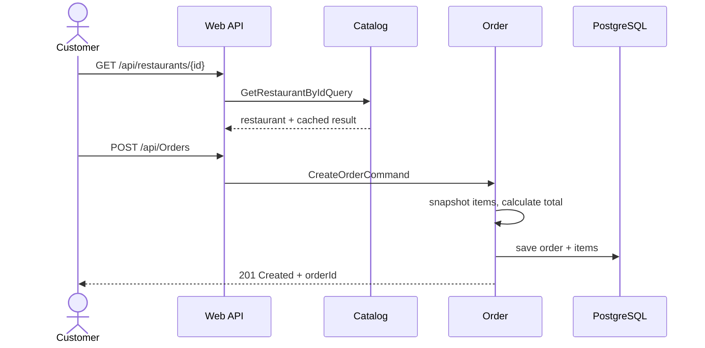
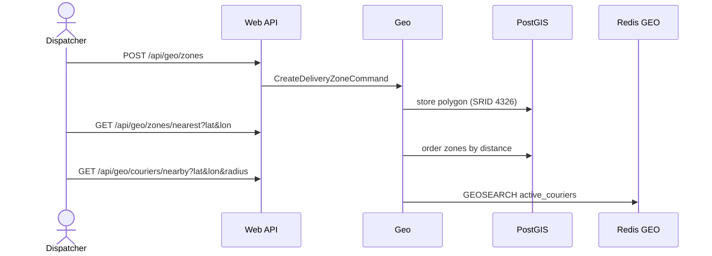
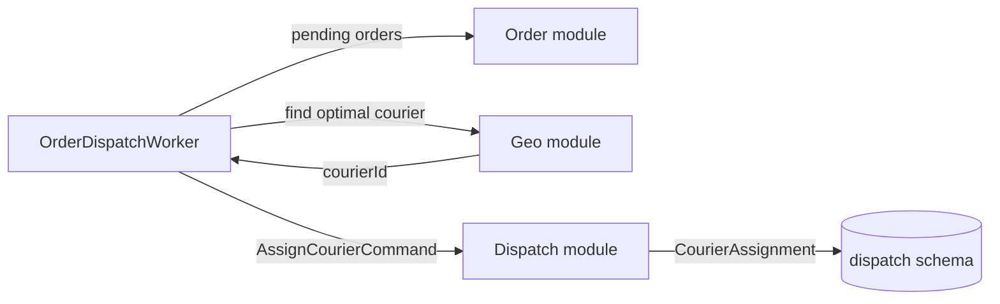
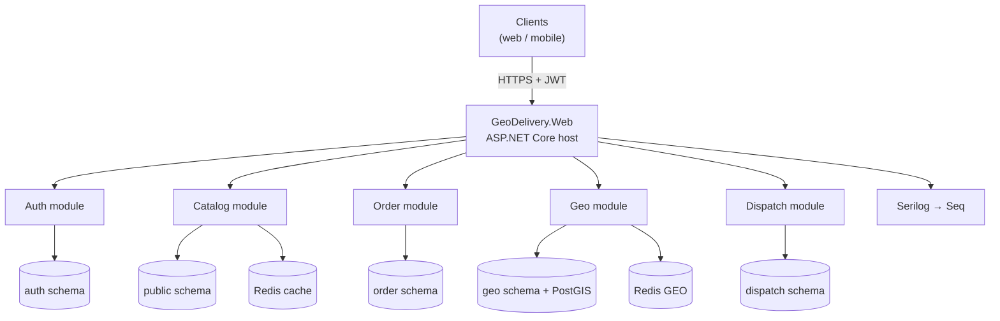

# GeoDelivery

**Backend platform for a food-delivery marketplace, built as a modular monolith with .NET 10, DDD, CQRS, PostgreSQL/PostGIS and Redis.**

GeoDelivery connects three sides of a delivery business in one API:

- **customers** browse restaurants, place orders and cancel them;
- **restaurants** publish their menu, categories and available dishes;
- **operators** manage delivery zones and assign couriers;
- **couriers** publish their live location for dispatch.

The system is implemented as a **modular monolith**: one deployable ASP.NET Core application, but five isolated business modules with their own domain models, handlers and database schemas. This keeps development and deployment simple while preserving clear boundaries for future scaling.


---

## Table of contents

- [What problem does GeoDelivery solve?](#what-problem-does-geodelivery-solve)
- [Business rules](#business-rules)
- [How the business flows work](#how-the-business-flows-work)
- [Architecture](#architecture)
- [Modules](#modules)
  - [Auth](#1-auth)
  - [Catalog](#2-catalog)
  - [Order](#3-order)
  - [Geo](#4-geo)
  - [Dispatch](#5-dispatch)
  - [Web](#web-host)
- [Technologies](#technologies)
- [Data storage](#data-storage)
- [Getting started](#getting-started)
- [API overview](#api-overview)
- [Examples](#examples)
- [Project status](#project-status)
- [Roadmap](#roadmap)
- [Contributing](#contributing)
- [License](#license)

---

## What problem does GeoDelivery solve?

A food-delivery business needs to answer four questions continuously:

1. **What can a customer order?** — restaurants, categories, dishes, prices and availability.
2. **What did the customer order and how much does it cost?** — orders, line items, delivery address and totals.
3. **Can we deliver there?** — delivery-zone polygons, distance and nearest-zone calculations.
4. **Who will deliver it?** — live courier locations and courier assignment.

GeoDelivery implements these capabilities as separate modules in one backend, with shared authentication and a consistent API. The result is an MVP-friendly system that can later be split into services module by module without rewriting the business logic.

### Actors and their use cases

| Actor | What they can do |
| --- | --- |
| **Customer** | Browse restaurants and dishes, create an order with a delivery address, view an order, cancel their own order |
| **Restaurant admin** | Create a restaurant, manage categories and dishes, mark a dish as unavailable |
| **Dispatcher / manager** | Create delivery zones, check whether a point is covered, find the nearest zone, inspect nearby couriers |
| **Courier** | Publish their current coordinates to the live GEO index |
| **System** | Issue and rotate JWTs, clean expired refresh tokens, run the courier-dispatch loop |

---

## Business rules

### Catalog

- A **restaurant** has a name, description and active flag.
- A **category** belongs to exactly one restaurant; the restaurant must exist.
- A **dish** belongs to exactly one restaurant and one category.
- A dish can only be created if its category belongs to the same restaurant.
- A dish must have a positive price and a non-empty name.
- A dish can be marked **unavailable**, so clients no longer show it as sellable.
- Catalog reads are public; catalog writes require the `Admin` role.

### Ordering

- An order is created for one restaurant, one customer and one delivery coordinate.
- An order contains line items; each line item stores a **snapshot** of the dish ID, name, unit price and quantity.
- The order total is calculated **on the server** as `Σ(price × quantity)`.
- Line-item prices are currently accepted from the request and are not yet re-checked against the Catalog; validating them against the menu is on the roadmap.
- An order carries the statuses `Created`, `Accepted`, `Cooking`, `ReadyForDelivery`, `Delivering`, `Completed` and `Cancelled`. Creation sets `Created`; cancellation sets `Cancelled`; enforced transitions between the remaining states are not implemented yet.
- A customer may cancel only **their own** order; the handler compares the order's customer ID with the supplied user ID.

### Delivery and dispatch

- A **delivery zone** is a polygon; at least three coordinate points are required and every point must be a valid latitude/longitude.
- A point can be checked against a zone, and the nearest **active** zone can be found.
- Courier positions are stored in a **Redis GEO** index under the `active_couriers` key.
- Nearby couriers are searched by a radius in kilometres.
- A courier must have the `Courier` role to publish a location.
- A courier assignment records the order, restaurant, courier, assignment status (`Pending`, `Assigned`, `Completed`, `Cancelled`) and timestamps.

### Identity and access

- Username and email must be unique.
- Passwords are hashed by ASP.NET Core Identity.
- Successful login returns a short-lived **access token** (10 minutes by default) and a **refresh token** (7 days by default).
- Refresh tokens are rotated on every refresh; old tokens are removed.
- API access is role-based: `Admin`, `Manager`, `Courier`, `Client`.
- New registrations receive the `User` role; privileged roles are not seeded automatically yet.

### Performance and reliability

- Selected catalog queries are cached in Redis for 5 minutes by default.
- Input is validated with FluentValidation before handlers run.
- Domain errors are translated to HTTP responses by centralized exception handlers.
- Each module owns its database schema, so one module's tables cannot be modified accidentally by another module's context.

---

## How the business flows work

### Customer places an order



### Dispatcher covers a delivery area



### Courier dispatch (intended flow)



---

## Architecture

GeoDelivery uses a **modular monolith** with **Domain-Driven Design** and **CQRS**.



### Architectural principles

- **One deployable unit.** A single Web API hosts all modules.
- **Module isolation.** Each module contains its own domain, application, infrastructure and presentation code.
- **No direct module references.** Modules do not reference each other's projects; in-process communication goes through MediatR requests.
- **Schema per module.** Modules share one PostgreSQL instance but own separate schemas.
- **CQRS.** Writes are commands, reads are queries; each has a dedicated handler.
- **Thin controllers.** Controllers only bind HTTP input and call `IMediator`.
- **Pipeline behaviors.** Validation, caching and Geo-specific validation run around handlers.
- **Vertical slices.** A feature's command/query, validator, DTO and handler live next to each other.

### Internal module layout

```text
<Module>/
├── Domain/          # Entities, value objects, enums, DTOs
├── Application/     # Commands, queries, handlers, validators, behaviors
├── Infrastructure/  # DbContext, EF Core mappings, migrations, external services
└── Presenters/      # API controllers (where the module exposes HTTP endpoints)
```

The `Web` project is the **composition root**: it references every module, registers dependencies and hosts the middleware pipeline.

---

## Modules

The solution contains **six projects: five business modules plus the Web host**.

| # | Module | Solves | Own data |
| --- | --- | --- | --- |
| 1 | **Auth** | Who the user is and what they may access | `auth` schema |
| 2 | **Catalog** | What restaurants sell and at what price | `public` schema + Redis cache |
| 3 | **Order** | What the customer ordered and its lifecycle | `order` schema |
| 4 | **Geo** | Where delivery is possible and where couriers are | `geo` schema + Redis GEO |
| 5 | **Dispatch** | Which courier is assigned to which order | `dispatch` schema |
| 6 | **Web** | Hosts everything behind one HTTP API | — |

### 1. Auth

**Task:** identity, authentication and role-based authorization.

- Registers users with unique username and email.
- Stores users, roles and refresh tokens through ASP.NET Core Identity.
- Issues JWT access tokens with role claims.
- Issues opaque refresh tokens and rotates them on refresh.
- Runs `RefreshTokenCleaner` daily to keep only the newest refresh token per user.
- Rejects expired or unknown refresh tokens.

**Key entities:** `User`, `Role`, `RefreshToken`.

**Endpoints:** `/api/User/register`, `/api/User/login`, `/api/User/refresh`.

### 2. Catalog

**Task:** restaurant and menu management.

- Creates and deletes restaurants.
- Looks up restaurants by ID or name.
- Creates categories inside a restaurant.
- Creates dishes inside a category and verifies that both belong to the same restaurant.
- Marks dishes unavailable.
- Lists categories and dishes for a restaurant, lists all categories, and resolves the category of a dish.
- Caches selected read queries in Redis.

**Key entities:** `Restaurant`, `Category`, `Dish`.

**Read model:** `RestaurantDto`, `CategoryDto`, `DishDto`.

**Endpoints:** `/api/restaurants`, `/api/restaurants/categories`, `/api/restaurants/dishes`.

### 3. Order

**Task:** turn a customer's basket into a persisted order and track its lifecycle.

- Creates an order with delivery coordinates and line items.
- Snapshots dish name and price at order time.
- Computes the order total from line items.
- Returns an order with all items.
- Cancels an order only if the requesting customer owns it.
- Exposes the order status enum.

**Key entities:** `Order`, `OrderItem`, `DeliveryAddress` (value object).

**Statuses:** `Created`, `Accepted`, `Cooking`, `ReadyForDelivery`, `Delivering`, `Completed`, `Cancelled`.

**Endpoints:** `/api/Orders`, `/api/Orders/{id}`, `/api/Orders/{id}/cancel`.

### 4. Geo

**Task:** answer geospatial questions for delivery.

- Creates delivery zones as PostGIS polygons (SRID 4326).
- Automatically closes a polygon if the first and last points differ.
- Checks whether a coordinate lies inside a zone.
- Finds the nearest active zone.
- Calculates distance between two coordinates.
- Stores live courier positions in Redis GEO.
- Finds couriers within a radius.
- Removes a courier from the GEO index.

**Key entities:** `DeliveryZone`, `Address`, `Location`.

**Storage:** PostGIS `geometry(Polygon, 4326)` with a GiST index; Redis sorted set for courier coordinates.

**Endpoints:** `/api/geo/zones`, `/api/geo/zones/{id}/check`, `/api/geo/zones/nearest`, `/api/geo/distance`, `/api/geo/couriers/*`.

### 5. Dispatch

**Task:** decide which courier should deliver an order.

- Defines the `CourierAssignment` aggregate.
- Tracks assignment state: `Pending`, `Assigned`, `Completed`, `Cancelled`.
- Persists assignments with order, restaurant and courier IDs.
- Provides `AssignCourierCommand`.
- Provides `FindOptimalCourierQuery` as the extension point for geo-based matching.
- Contains `OrderDispatchWorker`, a background loop that is intended to poll pending orders every 10 seconds and assign couriers.

**Key entity:** `CourierAssignment`.

**Current state:** the domain and persistence are in place; pending-order loading and courier selection are still placeholders.

### Web host

**Task:** compose modules into one HTTP application.

- Registers all `DbContext`s, MediatR handlers, validators, Redis and JWT authentication.
- Configures Swagger/OpenAPI.
- Applies exception-handling middleware.
- Configures Serilog sinks.
- Maps controllers from all modules.
- Runs background services (`RefreshTokenCleaner`, `OrderDispatchWorker`).

---

## Technologies

| Area | Technology | Why it is used |
| --- | --- | --- |
| Runtime | **.NET 10 / ASP.NET Core** | Modern LTS-track platform for the API |
| Language | **C# 14** | Records, pattern matching, primary constructors |
| Architecture | **Modular monolith, DDD, CQRS** | Clear boundaries without distributed-system overhead |
| In-process messaging | **MediatR 14** | Decouples controllers from handlers and enables pipeline behaviors |
| Validation | **FluentValidation 12** | Declarative command/query validation |
| ORM | **EF Core 10** | Mapping, migrations, LINQ queries |
| Database | **PostgreSQL 16 + PostGIS 3.4** | Reliable relational storage with native geospatial types |
| Geospatial | **NetTopologySuite** | Polygon operations and coordinate mapping |
| Cache / GEO | **Redis 7 + StackExchange.Redis** | Read-through caching and real-time courier positions |
| Identity | **ASP.NET Core Identity** | Password hashing, users, roles |
| Authentication | **JWT Bearer + refresh tokens** | Stateless API access with rotation |
| Logging | **Serilog + Seq** | Structured logs to console, files and Seq |
| API docs | **Swagger / Swashbuckle** | Interactive endpoint documentation |
| Infrastructure | **Docker Compose** | Local PostgreSQL/PostGIS and Seq |

---

## Data storage

GeoDelivery uses **one PostgreSQL database** (`catalog_service_db`) divided into schemas. This avoids cross-module foreign keys while keeping operations simple.

| Context | Schema | Tables |
| --- | --- | --- |
| `CatalogDbContext` | `public` | `restaurants`, `categories`, `dishes` |
| `AuthDbContext` | `auth` | `users`, `roles`, `refresh_tokens`, Identity tables |
| `OrderDbContext` | `order` | `Orders`, `OrderItems` |
| `GeoDbContext` | `geo` | `delivery_zones` |
| `DispatchDbContext` | `dispatch` | `CourierAssignments` |

Notable mappings:

- Money uses `numeric(18,2)`.
- Enums are stored as strings.
- Zone boundaries use `geometry(Polygon, 4326)` and a GiST index.
- EF Core uses snake_case naming via `EFCore.NamingConventions`.
- `DeliveryAddress` is an owned value object and is flattened into the `Orders` table.

---

## Getting started

### Prerequisites

- [.NET 10 SDK](https://dotnet.microsoft.com/download)
- [Docker Desktop](https://www.docker.com/products/docker-desktop/)
- [EF Core CLI](https://learn.microsoft.com/ef/core/cli/dotnet)
- Redis 7

### 1. Clone and enter the solution

```bash
git clone https://github.com/ToshmatovDeveloper/GeoDelivery.git
cd GeoDelivery/GeoDelivery
```

### 2. Start PostgreSQL/PostGIS and Seq

```bash
docker compose up -d
```

| Service | Address | Credentials |
| --- | --- | --- |
| PostgreSQL 16 + PostGIS | `localhost:5432` | `postgres` / `postgres`, db `catalog_service_db` |
| Seq | <http://localhost:8080> | no auth in development |

Redis is not yet part of the compose file; start it separately:

```bash
docker run -d --name geodelivery-redis -p 6379:6379 redis:7-alpine
```

### 3. Build

```bash
dotnet restore
dotnet build
```

### 4. Create the database schema

```bash
dotnet ef database update --context CatalogDbContext  --project Catalog  --startup-project Web
dotnet ef database update --context OrderDbContext    --project Order    --startup-project Web
dotnet ef database update --context DispatchDbContext --project Dispatch --startup-project Web
```

The committed **Auth** migration is missing and the **Geo** migration is empty. To create those tables locally:

```bash
# Auth
rm Auth/Infrastructure/Migrations/AuthDbContextModelSnapshot.cs
dotnet ef migrations add InitialAuth --context AuthDbContext --project Auth --startup-project Web --output-dir Infrastructure/Migrations
dotnet ef database update --context AuthDbContext --project Auth --startup-project Web

# Geo
dotnet ef migrations remove --context GeoDbContext --project Geo --startup-project Web
dotnet ef migrations add InitialGeo --context GeoDbContext --project Geo --startup-project Web --output-dir Infrastructure/Migrations
dotnet ef database update --context GeoDbContext --project Geo --startup-project Web
```

On Windows, use `Remove-Item` instead of `rm`.

### 5. Run

```bash
dotnet run --project Web
```

| Resource | URL |
| --- | --- |
| HTTP API | <http://localhost:5282> |
| HTTPS API | <https://localhost:7237> |
| Swagger UI | <http://localhost:5282/swagger> |
| Seq UI | <http://localhost:8080> |

### Configuration

Settings live in `Web/appsettings.json` and `Web/appsettings.Development.json`. Override them with environment variables using `__` as the separator.

| Key | Meaning | Default |
| --- | --- | --- |
| `ConnectionStrings:DefaultConnectionString` | PostgreSQL connection | `localhost:5432`, `catalog_service_db` |
| `ConnectionStrings:Redis` | Redis endpoint | `localhost:6379` |
| `CacheSettings:TimeToLive` | Cache TTL | `00:05:00` |
| `JwtSettings:Secret` | JWT signing key | development placeholder |
| `JwtSettings:Issuer` / `Audience` | Token issuer and audience | `https://localhost:7237` |
| `JwtSettings:ExpirationInMinutes` | Access-token lifetime | `10` |
| `JwtSettings:RefreshTokenExpirationInDays` | Refresh-token lifetime | `7` |

Example:

```bash
export ConnectionStrings__DefaultConnectionString="Host=...;Database=...;Username=...;Password=..."
export JwtSettings__Secret="a-long-random-secret"
```

> Replace the development JWT secret and database password before any real deployment.

---

## API overview

Base URL: `http://localhost:5282`. Protected routes require `Authorization: Bearer <access-token>`.

### Auth

| Method | Route | Access | Purpose |
| --- | --- | --- | --- |
| `POST` | `/api/User/register` | Anonymous | Create an account and receive tokens |
| `POST` | `/api/User/login` | Anonymous | Authenticate and receive tokens |
| `POST` | `/api/User/refresh` | Anonymous | Rotate a refresh token |

### Catalog

| Method | Route | Access | Purpose |
| --- | --- | --- | --- |
| `POST` | `/api/restaurants` | `Admin` | Create a restaurant |
| `GET` | `/api/restaurants/{id}` | Public | Get a restaurant |
| `GET` | `/api/restaurants/by-name/{name}` | Public | Find a restaurant by name |
| `DELETE` | `/api/restaurants/{id}` | `Admin` | Delete a restaurant |
| `POST` | `/api/restaurants/categories` | `Admin` | Create a category |
| `GET` | `/api/restaurants/categories?restaurantId=` | Public | List restaurant categories |
| `GET` | `/api/categories` | Public | List all categories |
| `GET` | `/api/restaurants/categories/dishes/{dishId}?restaurantId=` | Public | Get a dish's category |
| `DELETE` | `/api/restaurants/categories/{categoryId}?restaurantId=` | `Admin` | Delete a category |
| `POST` | `/api/restaurants/dishes` | `Admin` | Create a dish |
| `GET` | `/api/restaurants/dishes/{id}?restaurantId=` | Public | Get a dish |
| `GET` | `/api/restaurants/dishes/by-name/{name}` | Public | Find a dish by name |
| `GET` | `/api/restaurants/dishes?restaurantId=` | Public | List dishes of a restaurant |
| `PATCH` | `/api/restaurants/dishes/{id}/unavailable` | `Admin` | Mark a dish unavailable |

### Orders

| Method | Route | Access | Purpose |
| --- | --- | --- | --- |
| `POST` | `/api/Orders` | Public (see roadmap) | Create an order |
| `GET` | `/api/Orders/{id}` | Public (see roadmap) | Get an order with items |
| `POST` | `/api/Orders/{id}/cancel` | Public; `userId` in body | Cancel an order |

### Geo

| Method | Route | Access | Purpose |
| --- | --- | --- | --- |
| `POST` | `/api/geo/zones` | `Admin`, `Manager` | Create a delivery zone |
| `GET` | `/api/geo/zones/{zoneId}/check?latitude=&longitude=` | `Admin`, `Manager`, `Client` | Check point coverage |
| `GET` | `/api/geo/zones/nearest?latitude=&longitude=` | `Admin`, `Manager`, `Client` | Find nearest active zone |
| `GET` | `/api/geo/distance?lat1=&lon1=&lat2=&lon2=` | `Admin`, `Manager`, `Client` | Distance between points |
| `POST` | `/api/geo/couriers/location` | `Courier` | Publish courier position |
| `GET` | `/api/geo/couriers/nearby?latitude=&longitude=&radiusInKm=` | `Admin`, `Manager` | Find couriers in radius |
| `DELETE` | `/api/geo/couriers/{courierId}` | `Admin` | Remove courier from GEO index |

---

## Examples

### Register and log in

```bash
curl -X POST http://localhost:5282/api/User/register \
  -H "Content-Type: application/json" \
  -d '{"userName":"jane","email":"jane@example.com","password":"P@ssw0rd123"}'

curl -X POST http://localhost:5282/api/User/login \
  -H "Content-Type: application/json" \
  -d '{"email":"jane@example.com","password":"P@ssw0rd123"}'
```

### Create a restaurant, category and dish

```bash
curl -X POST http://localhost:5282/api/restaurants \
  -H "Authorization: Bearer $TOKEN" \
  -H "Content-Type: application/json" \
  -d '{"name":"Pasta Palace","description":"Fresh pasta every day","isActive":true}'

curl -X POST http://localhost:5282/api/restaurants/categories \
  -H "Authorization: Bearer $TOKEN" \
  -H "Content-Type: application/json" \
  -d '{"restaurantId":"<restaurant-id>","name":"Main courses"}'

curl -X POST http://localhost:5282/api/restaurants/dishes \
  -H "Authorization: Bearer $TOKEN" \
  -H "Content-Type: application/json" \
  -d '{"restaurantId":"<restaurant-id>","categoryId":"<category-id>","name":"Carbonara","price":12.50,"isAvailable":true}'
```

### Place and cancel an order

```bash
curl -X POST http://localhost:5282/api/Orders \
  -H "Content-Type: application/json" \
  -d '{
    "restaurantId":"<restaurant-id>",
    "userId":"<customer-id>",
    "latitude":41.3111,
    "longitude":69.2797,
    "items":[{"dishId":"<dish-id>","dishName":"Carbonara","quantity":2,"price":12.50}]
  }'

curl -X POST http://localhost:5282/api/Orders/<order-id>/cancel \
  -H "Content-Type: application/json" \
  -d '"<customer-id>"'
```

### Create a delivery zone and update a courier position

```bash
curl -X POST http://localhost:5282/api/geo/zones \
  -H "Authorization: Bearer $TOKEN" \
  -H "Content-Type: application/json" \
  -d '{
    "name":"Downtown",
    "isActive":true,
    "points":[
      {"latitude":41.30,"longitude":69.26},
      {"latitude":41.32,"longitude":69.26},
      {"latitude":41.32,"longitude":69.29},
      {"latitude":41.30,"longitude":69.29}
    ]
  }'

curl -X POST http://localhost:5282/api/geo/couriers/location \
  -H "Authorization: Bearer $COURIER_TOKEN" \
  -H "Content-Type: application/json" \
  -d '{"courierId":"<courier-id>","latitude":41.3111,"longitude":69.2797}'

curl "http://localhost:5282/api/geo/couriers/nearby?latitude=41.3111&longitude=69.2797&radiusInKm=3" \
  -H "Authorization: Bearer $TOKEN"
```

---

## Project status

| Capability | Status |
| --- | --- |
| Registration, login, refresh, token cleanup | Implemented |
| Restaurants, categories, dishes | Implemented |
| Order creation, retrieval, cancellation | Implemented |
| PostGIS delivery zones and Redis GEO | Implemented |
| Courier assignment domain | Implemented |
| Automatic dispatch | Placeholder — worker and courier selection are not wired to real data |
| Role seeding | Not implemented |
| Automated tests / CI | Not implemented |

---

## Roadmap

- [ ] Connect `OrderDispatchWorker` to pending orders and implement real courier matching.
- [ ] Protect order endpoints with JWT and read the customer ID from claims.
- [ ] Validate order line-item prices against the Catalog instead of trusting the request.
- [ ] Seed Identity roles and add an admin bootstrap flow.
- [ ] Commit complete Auth and Geo migrations.
- [ ] Add unit/integration tests and GitHub Actions CI.
- [ ] Add Redis to `docker-compose.yml` and create an API `Dockerfile`.
- [ ] Invalidate cache entries on catalog writes.
- [ ] Move secrets out of `appsettings.json`.
- [ ] Use geodesic distance instead of the planar approximation.
- [ ] Add payment, notifications and real-time order tracking modules.

Planned work is tracked in [GitHub Issues](https://github.com/ToshmatovDeveloper/GeoDelivery/issues).

---

## Contributing

1. Branch from `main`:
   ```bash
   git checkout -b features/issue-<number>
   ```
2. Keep a change scoped to one module or concern.
3. Follow the existing CQRS/DDD structure and add validators for new commands.
4. Build before opening a pull request:
   ```bash
   dotnet build
   ```
5. Describe the affected module and how the change was verified.

---

## License

No license file is included in this repository yet. Until one is added, the code is **all rights reserved**; contact the repository owner for permission to use or distribute it.
